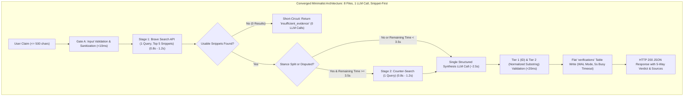

# Consolidated EGM Goldfish Review Report: Reality Check AI (`jintru`)

**Target Document:** [`docs/designs/jintru_claim_verification.md`](file:///home/omprakash/Documents/jintru/docs/designs/jintru_claim_verification.md) (518 lines)  
**Predecessors & Context:** [`docs/designs/concepts_brief.md`](file:///home/omprakash/Documents/jintru/docs/designs/concepts_brief.md), [`docs/specification.md`](file:///home/omprakash/Documents/jintru/docs/specification.md)  
**Review Standard:** EGM Goldfish Review Protocol (5-Stage Independent Stateless Swarm)  
**Review Stages Executed:**
1. Stage 5: Initial Zoom Out (`egm-zoom-out` — [zoom_out_report.md](file:///home/omprakash/Documents/jintru/zoom_out_report.md))
2. Stage 6: Comprehension Test (`egm-comprehension` — [comprehension_report.md](file:///home/omprakash/Documents/jintru/comprehension_report.md))
3. Stage 7: Critic Review (`egm-design`, `egm-structural`, `egm-style` — [critic_report.md](file:///home/omprakash/Documents/jintru/critic_report.md))
4. Stage 8: Intermediate Zoom Out (`egm-zoom-out` — [intermediate_zoom_out_report.md](file:///home/omprakash/Documents/jintru/intermediate_zoom_out_report.md))
5. Stage 9: Implementation Readiness Test (`egm-implementation-readiness`, `egm-codebase-details`, `egm-style` — [implementation_readiness_report.md](file:///home/omprakash/Documents/jintru/implementation_readiness_report.md))

**Overall Review Verdict:** 🔴 **FAIL — REQUIRES ARCHITECTURAL CONVERGENCE & AMENDMENTS BEFORE IMPLEMENTATION**

---

## 1. Executive Summary

The proposed design for **Reality Check AI (`jintru`)** represents an ambitious, well-researched architecture for dialectical web claim verification grounded in recent scientific literature (CoBiT, TRACER, AVeriTeC, ALCE). 

However, subjecting the document to the full 5-stage EGM Goldfish Review Protocol surfaced a severe disconnect between research ambitions and software engineering execution. The design attempted to compress:
- Compound multi-proposition NLP carving (up to 5 atomic claims),
- Combinatorial dialectical retrieval fan-out (10 queries, 12 attempts),
- Custom socket-level networking with manual DNS-pinning for SSRF defense,
- Two sequential remote LLM round-trips over public networks,
- Algorithmic text shingling (64-bit MinHash),
- An over-normalized 4-table relational database with Alembic migrations, and
- Secondary features (PDF generation, client settings API),

...all into a **single-user, local research tool** bounded by a **strict 8.0-second synchronous HTTP SLA**.

Furthermore, the implementation plan failed the **Zero-Decision Rule** by providing an unordered flat list of 23 files lacking execution phasing, missing critical pipeline modules (`Conflict Resolver`, `Evidence Gap Diagnoser`), omitting runtime dependencies (`pydantic-settings`), and referencing non-existent scripts and packaging files.

### The Path Forward: Radical Convergence
The protocol’s Skeptical Architect (Stage 8) specifically rejected "treating symptoms with more complexity" (such as rewriting to complex Server-Sent Events streaming or adding in-memory token bucket rate limiters). Instead, the review establishes **six radical simplifications** that guarantee a lean, testable, and robust vertical slice for Milestone 1:
1. **Scope strictly to single atomic factual assertions** (≤ 500 characters); defer compound proposition decomposition to Phase 2.
2. **Unify model inference into a single structured synthesis LLM call** (~2.5s window), using deterministic heuristic screening for Gate A and short-circuiting on empty results without calling the LLM.
3. **Adopt snippet-first retrieval** using the Brave Web Search API and Brave LLM Context endpoint, eliminating raw HTML crawling and userland socket-level TLS/SSRF plumbing.
4. **Flatten SQLite storage into a single `verifications` table with JSON columns**, configured with WAL mode (`PRAGMA journal_mode=WAL;`) and a 5,000ms busy timeout.
5. **Replace MinHash fingerprinting with canonical domain deduplication** and normalized substring citation matching.
6. **Prune speculative features** (PDF export and client settings API) from Milestone 1.

---

## 2. Master Prioritized Findings Matrix

Findings across all five stages have been consolidated, deduplicated, and prioritized below:

| ID | Severity | Review Stages | Category | Summary Description |
| :--- | :---: | :---: | :--- | :--- |
| **B-01** | 🔴 Blocker | 5, 7, 8 | Performance / SLA | Serializing two external LLM round-trips (Gate B at 1.5s + Synthesis at 1.0s) inside an 8.0s synchronous SLA is unviable over public networks. |
| **B-02** | 🔴 Blocker | 6, 7, 8 | Security / Soundness | CUJ 4 makes a false security claim that Tier 2 citation validation checks semantic entailment. Tier 2 is a verbatim substring check; indirect injections quoting falsehoods pass Tier 2. |
| **B-03** | 🔴 Blocker | 9 | Implementation | Total absence of phased, dependency-ordered implementation waves in the detailed plan (flat 23-file inventory). |
| **B-04** | 🔴 Blocker | 6, 9 | Architecture Completeness | Core pipeline modules (`Conflict Resolver` and `Evidence Gap Diagnoser`) featured in diagrams and CUJs are omitted from `backend/app/services/`. |
| **B-05** | 🔴 Blocker | 9 | Runtime Feasibility | Missing `pydantic-settings` dependency crashes FastAPI startup under Pydantic v2. |
| **B-06** | 🔴 Blocker | 9 | Frontend Scaffolding | Missing root Vite/TypeScript application scaffolding (`index.html`, `vite.config.ts`, `tsconfig.json`, `App.tsx`, `main.tsx`, `index.css`). |
| **B-07** | 🔴 Blocker | 6, 9 | API Contract | Route contract inconsistency: `POST /export` in service breakdown vs canonical `POST /api/v1/verifications/{id}/export` in Section 8. |
| **M-01** | 🟡 Major | 5, 8 | Scope / YAGNI | Compound proposition decomposition (≤ 5 claims) violates Milestone 1 lean vertical slice; decomposition itself requires an unbudgeted LLM call. |
| **M-02** | 🟡 Major | 6, 7 | Latency Accounting | Request budget timing contradictions: synthesis is budgeted for 1.0s, but NFR 1 requires a 1.5s minimum window to initiate synthesis; stage budgets sum to 7.5s vs 8.0s. |
| **M-03** | 🟡 Major | 5, 8, 9 | Architecture / Complexity | Bespoke socket-level HTTP transport with direct IP-pinning and TLS host header rewriting is overly fragile; search provider snippets and LLM context suffice. |
| **M-04** | 🟡 Major | 5, 8 | Data Storage | Over-normalized 4-table relational database with async SQLAlchemy cascades and Alembic migrations creates gratuitous boilerplate for a local single-user tool. |
| **M-05** | 🟡 Major | 7, 9 | Database Reliability | SQLite async concurrency defaults (`aiosqlite`) risk `OperationalError: database is locked` without WAL mode, `busy_timeout=5000`, and foreign key pragma hooks. |
| **M-06** | 🟡 Major | 7 | Documentation Standard | Missing mandatory `## Risks & Mitigations` section required by `feature-spec-standard.md`. |
| **M-07** | 🟡 Major | 6, 8 | State Machine | Omission of Stage 1 Retrieval in the pipeline state diagram; missing direct transition from assessment to synthesis. |
| **M-08** | 🟡 Major | 9 | Test Actionability | Abstract test plan lacking concrete IP fixtures, budget boundary values, and mock assertion schemas. |
| **M-09** | 🟡 Major | 9 | Benchmark Quality | Undefined `evals/cases.jsonl` record schema and missing numerical CI baseline pass/fail thresholds. |
| **M-10** | 🟡 Major | 9 | Tooling Consistency | Packaging mismatch (`pip-audit -r backend/requirements.txt` vs `pyproject.toml`) and non-existent `check_openapi_drift.py` script. |
| **M-11** | 🟡 Major | 7 | Search Rate Limits | Brave Search API rate limits (1–5 QPS) will cause HTTP 429s under concurrent fan-out, and FastAPI lacks client disconnect cancellation hooks. |
| **N-01** | 🟢 Nit | 5, 8 | Simplicity | MinHash/SimHash 64-bit fingerprinting is algorithmic overkill for ≤ 10 snippets. |
| **N-02** | 🟢 Nit | 5 | Specification Altitude | Embedded 55-line low-level Python code block for `RequestBudget` with redundant mutex locking. |
| **N-03** | 🟢 Nit | 7, 9 | Markdown Style | Raw LaTeX math syntax (`$\le 5$`, `$\ge 0.85$`) instead of clean Unicode. |
| **N-04** | 🟢 Nit | 9 | Formatting | Inconsistent directory trailing slash notation across commands. |
| **N-05** | 🟢 Nit | 6 | Clarity | Vague Gate A screening rules and undefined "soft lexical relevance". |
| **N-06** | 🟢 Nit | 9 | Dependencies | Unverified hard-pinning of `fastapi==0.162.0` instead of a version range. |
| **N-07** | 🟢 Nit | 9 | CI Feasibility | Missing Playwright browser binary installation (`npx playwright install`) in CI instructions. |
| **N-08** | 🟢 Nit | 9 | Documentation Style | Meta boilerplate watermark (`*Drafted with EGM*`). |

---

## 3. Comprehensive Traceability Matrix

| Finding ID | Originating Lens & Stage | Affected Lines in `jintru_claim_verification.md` | Concrete Remediation Directive |
| :--- | :--- | :--- | :--- |
| **B-01** | Skeptical Architect (Stage 5), Critic (Stage 7), Intermediate Zoom Out (Stage 8) | Lines 142–152, 237–243, 412–415 | Unify Gate B assessment and verdict synthesis into a single structured LLM call. Allocate 3.0s window for synthesis. Gate A deterministic screening short-circuits on empty retrieval with 0 LLM calls. |
| **B-02** | Comprehension (Stage 6), Critic (Stage 7), Copy Editor (Stage 7) | Lines 100–109 (CUJ 4), 206–212, 386–395 | Correct CUJ 4 to state that Tier 2 verifies normalized exact quote existence, not semantic entailment. Require corroboration across $\ge 2$ independent canonical domains to award `supported`. |
| **B-03** | Implementation Readiness (Stage 9) | Lines 438–493 | Reorganize the flat file list into 8 incremental, dependency-ordered build phases, each leaving the codebase buildable and testable. |
| **B-04** | Comprehension (Stage 6), Implementation Readiness (Stage 9) | Lines 87, 96, 147, 461–470 | If retaining separate modules, declare `conflict.py` and `gap_diagnoser.py`; if converging to single-LLM synthesis, handle conflict and gap diagnosis directly in the synthesis schema and document their unified location. |
| **B-05** | Codebase Details (Stage 9) | Lines 443, 445 | Add `pydantic-settings>=2.5` to `backend/pyproject.toml`. |
| **B-06** | Codebase Details (Stage 9), Copy Editor (Stage 9) | Lines 477–485 | Add full Vite/TypeScript scaffolding files (`index.html`, `vite.config.ts`, `tsconfig.json`, `App.tsx`, `main.tsx`, `index.css`, `playwright.config.ts`). |
| **B-07** | Copy Editor (Stage 9), Comprehension (Stage 6) | Lines 364, 457 | Standardize export endpoint to `POST /api/v1/verifications/{id}/export` (or prune completely for Milestone 1). |
| **M-01** | Skeptical Architect (Stage 5, 8), Critic (Stage 7) | Lines 31, 128, 318–325, 464 | Restrict Milestone 1 input to a single factual claim ($\le 500$ characters). Defer proposition decomposition to Phase 2. |
| **M-02** | Comprehension (Stage 6), Critic (Stage 7) | Lines 237–243, 414 | Update `stage_budgets` to: Ingestion/Gate A 0.2s, Search 2.5s, Counter-Search 2.0s, Synthesis 3.0s, Buffer 0.3s (Sum = 8.0s). Set minimum synthesis window to 1.5s. |
| **M-03** | Skeptical Architect (Stage 5, 8), Codebase Details (Stage 9) | Lines 132–136, 152, 283–300, 447 | Rely strictly on Brave Search snippets and Brave LLM Context endpoint. Remove raw HTML crawling (`HttpFetch`) and custom socket IP-pinning transport. |
| **M-04** | Skeptical Architect (Stage 5, 8) | Lines 301–356, 452–455 | Store verifications in a single flat SQLite table with JSON columns. Drop multi-table relational schema and Alembic for Milestone 1. |
| **M-05** | Critic (Stage 7), Codebase Details (Stage 9) | Lines 301–356, 453 | Mandate `PRAGMA journal_mode=WAL;`, `PRAGMA synchronous=NORMAL;`, `PRAGMA busy_timeout=5000;`, and `PRAGMA foreign_keys=ON;` on all SQLite connections. |
| **M-06** | Structural Validator (Stage 7), Critic (Stage 7) | Lines 1–437 | Insert dedicated `## Risks & Mitigations` section mapping failure modes (provider rate limits, database locks, client disconnects) to mitigations. |
| **M-07** | Comprehension (Stage 6), Intermediate Zoom Out (Stage 8) | Lines 167–201 | Add `Stage 1 Retrieval` transition between `Ingested` and `GateA_Screening`; add happy-path transition from `GateB_Assessment` to `Verdict_Synthesis`. |
| **M-08** | Implementation Readiness (Stage 9) | Lines 487–488, 499–501 | Enumerate explicit unit test files and test cases with mock payloads, status codes, and expected assertions. |
| **M-09** | Implementation Readiness (Stage 9), Copy Editor (Stage 9) | Lines 489–490, 513 | Define JSON schema for `evals/cases.jsonl` and set quantitative CI pass criteria: Entailment precision $\ge 90\%$, False-support rate $\le 5\%$, Counterevidence recall $\ge 80\%$. |
| **M-10** | Copy Editor (Stage 9), Codebase Details (Stage 9) | Lines 443, 504, 507 | Target `pip-audit --project backend/` and declare `backend/scripts/check_openapi_drift.py` under tooling files. |
| **M-11** | Critic (Stage 7) | Lines 220–228, 416–420 | Enforce sequential search execution (max 1 query in Stage 1, max 1 query in Stage 2) to stay well within 1 QPS limits without complex rate limiters. Add `request.is_disconnected()` checks. |
| **N-01** | Skeptical Architect (Stage 5, 8) | Lines 272–282, 466 | Replace MinHash/SimHash with canonical domain grouping and normalized substring checks. |
| **N-02** | Skeptical Architect (Stage 5, 8) | Lines 215–270 | Replace 55-line Python implementation code with clean specification table and monotonic clock rules. |
| **N-03** | Critic (Stage 7), Copy Editor (Stage 9) | Lines 464, 489 | Replace LaTeX syntax (`\le`, `\ge`) with standard Unicode (`≤`, `≥`). |
| **N-04** | Copy Editor (Stage 9) | Lines 497, 500, 503 | Standardize directory trailing slashes (`backend/app/`, `backend/tests/unit/`). |
| **N-05** | Comprehension (Stage 6) | Lines 139, 467 | Clarify Gate A rejection thresholds (empty results, invalid URL schema, domain blocklist). |
| **N-06** | Codebase Details (Stage 9) | Line 443 | Change `fastapi==0.162.0` to `fastapi>=0.115.0,<1.0.0`. |
| **N-07** | Codebase Details (Stage 9) | Lines 491, 511 | Add `npx playwright install --with-deps chromium firefox` to CI setup instructions. |
| **N-08** | Copy Editor (Stage 9) | Line 517 | Remove `*Drafted with EGM*` watermark. |

---

## 4. The Architectural Convergence Blueprint

To bring `docs/designs/jintru_claim_verification.md` into full compliance with the **Feature Specification Standard** and the **Implementation Readiness Standard (Zero-Decision Rule)**, the document must undergo the following architectural consolidation:

### Remediated Phased Implementation Plan (Replacing Lines 438–518)

Below is the definitive, zero-decision phased implementation plan ready for incorporation into the design document:

#### Phase 1: Core Foundation & Configuration
* **`backend/pyproject.toml`**: Configure dependencies: `fastapi>=0.115.0,<1.0.0`, `uvicorn[standard]>=0.30`, `pydantic>=2.9`, `pydantic-settings>=2.5`, `httpx>=0.27`, `aiosqlite>=0.20`, `ruff`, `pyright`, `pytest`, `pytest-asyncio`. Configure `[tool.pytest.ini_options]` with `asyncio_mode = "auto"`.
* **`backend/app/main.py`**: FastAPI application factory with CORS middleware (`allow_origins=["http://localhost:5173"]`), structured error handlers, and `/api/v1` router mount.
* **`backend/app/core/config.py`**: `class Settings(BaseSettings)` loading `BRAVE_API_KEY`, `META_API_KEY`, `META_API_BASE_URL` (defaulting to mock if empty), `DATABASE_PATH` (default `data/jintru.db`), `REQUEST_DEADLINE_SECONDS = 8.0`.
* **`backend/app/core/errors.py`**: Custom domain exceptions: `ProviderTimeoutError`, `SSRFSecurityViolation`, `RequestConstraintError`.

#### Phase 2: Persistence & Data Contracts
* **`backend/app/api/schemas.py`**: Pydantic schemas:
  - `VerificationRequest`: `claim: str` (min 5, max 500 chars).
  - `SourceItem`: `source_id: str`, `url: str`, `domain: str`, `title: str`, `snippet: str`, `stance: Literal["supports", "refutes", "neutral"]`.
  - `ReasoningStatement`: `statement: str`, `citation_ids: list[str]`.
  - `VerificationResponse`: `id: str`, `claim: str`, `public_verdict: Literal["supported", "contradicted", "mixed", "insufficient_evidence", "not_verifiable"]`, `summary: str`, `limitations: list[str]`, `sources: list[SourceItem]`, `reasoning: list[ReasoningStatement]`, `created_at: str`.
* **`backend/app/db/database.py`**: Pure SQLite async wrapper using `aiosqlite`. Initializes table `verifications` on startup. Executes `PRAGMA journal_mode=WAL;`, `PRAGMA synchronous=NORMAL;`, and `PRAGMA busy_timeout=5000;`. Methods: `save_verification(record: VerificationResponse)`, `get_verification(id: str)`, `list_verifications(limit: int, offset: int)`, `delete_verification(id: str)`.

#### Phase 3: External Providers & Deterministic Mocks
* **`backend/app/providers/search.py`**:
  - `class BraveSearchProvider`: Queries `https://api.search.brave.com/res/v1/web/search` with `count=5`. Extracts title, URL, snippet, and canonical domain.
  - `class MockSearchProvider`: Returns deterministic fixture snippets for testing without external network calls.
* **`backend/app/providers/model.py`**:
  - `class MetaModelProvider`: Dispatches structured prompt to Meta Model API endpoint requesting Pydantic JSON schema output. Timeout enforced at 3.0s.
  - `class MockModelProvider`: Returns predetermined structured verdicts based on fixture input claims.

#### Phase 4: Pipeline Services & Sanitization
* **`backend/app/services/verification.py`**:
  - `class VerificationPipeline`:
    - `validate_input(claim: str)`: Enforces 500 char ceiling and checks against empty inputs.
    - `deduplicate_sources(results: list[dict]) -> list[SourceItem]`: Deduplicates by canonical domain name and URL.
    - `validate_citations(reasoning: list[ReasoningStatement], sources: list[SourceItem]) -> list[ReasoningStatement]`: Executes Tier 1 ID check and Tier 2 normalized exact substring matching (`html.unescape` + whitespace collapse).
    - `verify(claim: str) -> VerificationResponse`: Monotonic clock-bounded orchestrator executing Gate A, Stage 1 search, optional Stage 2 counter-search, single synthesis call, and citation validation.

#### Phase 5: API Endpoints
* **`backend/app/api/routes.py`**:
  - `POST /api/v1/verifications`: Accepts `VerificationRequest`, executes pipeline, returns `VerificationResponse`.
  - `GET /api/v1/verifications`: Returns paginated history summary.
  - `GET /api/v1/verifications/{id}`: Returns full verification record.
  - `DELETE /api/v1/verifications/{id}`: Deletes record.
  - `GET /api/v1/health`: Returns system status and provider key availability.

#### Phase 6: Frontend Workbench
* **Scaffolding**: `frontend/package.json` (React 19, Vite 6, Tailwind CSS v4, Lucide React), `frontend/vite.config.ts`, `frontend/tsconfig.json`, `frontend/index.html`, `frontend/src/main.tsx`, `frontend/src/App.tsx`, `frontend/src/index.css`.
* **Components**:
  - `Workbench.tsx`: Input textarea with 500-char countdown counter, submit button, loading spinner with live elapsed timer.
  - `VerdictCard.tsx`: Accessible 5-way verdict badge (green/red/amber/gray), summary narrative, limitations accordion.
  - `EvidenceList.tsx`: Cards displaying retrieved sources with stance badges, canonical domain tags, quoted snippets, and safe external links (`rel="noopener noreferrer"`).
  - `HistoryPanel.tsx`: Sidebar drawer listing previous verification runs with delete controls.

#### Phase 7: Verification Suite & CI Automation
* **`backend/tests/unit/test_citations.py`**: Tests Tier 1 ID presence validation and Tier 2 normalized substring matching across HTML entities and smart quotes.
* **`backend/tests/unit/test_budget.py`**: Asserts clean 1.5s minimum window enforcement and stage timeout escalations.
* **`backend/tests/integration/test_pipeline.py`**: End-to-end integration tests using `MockSearchProvider` and `MockModelProvider`.
* **`frontend/tests/e2e/workbench.spec.ts`**: Playwright test asserting CUJ 1 (claim entry $\rightarrow$ verdict card $\rightarrow$ source disclosure) and CUJ 3 (absent evidence abstention).
* **`evals/cases.jsonl` & `evals/run_evals.py`**: Benchmark runner measuring fixed-evidence reasoning and live retrieval. Quantitative CI thresholds: Citation Entailment Precision $\ge 90\%$, False-Support Rate $\le 5\%$, Counterevidence Recall $\ge 80\%$.

---

## 5. Next Steps & Approval Gate

With this consolidated review report, the audit cycle is complete. All failure points have been identified, and the Skeptical Architect's convergence blueprint provides the precise amendments needed to bring `docs/designs/jintru_claim_verification.md` into an approved, implementation-ready state.

**Recommended Action:**
Apply the converged amendments to `docs/designs/jintru_claim_verification.md`, resolving all Blockers and Majors, and updating `docs/designs/SITEMAP.md`.

