# Intermediate Zoom Out Architectural Audit: `docs/designs/jintru_claim_verification.md`

**Auditor:** Skeptical Architect (Zoom Out Goldfish — Stage 8)  
**Standard Applied:** [Zoom Out Standard](file:///home/omprakash/.gemini/config/plugins/egm/resources/document_standards/zoom-out-standard.md)  
**Target Document:** [`docs/designs/jintru_claim_verification.md`](file:///home/omprakash/Documents/jintru/docs/designs/jintru_claim_verification.md)  
**Context Documents:** [`docs/designs/concepts_brief.md`](file:///home/omprakash/Documents/jintru/docs/designs/concepts_brief.md), [`docs/specification.md`](file:///home/omprakash/Documents/jintru/docs/specification.md)  
**Prior Stage Reports:** [`zoom_out_report.md`](file:///home/omprakash/Documents/jintru/zoom_out_report.md), [`comprehension_report.md`](file:///home/omprakash/Documents/jintru/comprehension_report.md), [`critic_report.md`](file:///home/omprakash/Documents/jintru/critic_report.md)  
**Mode:** REVIEW (Stage 8 Intermediate Zoom Out)  

---

### Executive Re-Evaluation (The 30,000-Foot Diagnosis)

The `jintru` design document represents a conceptually rich synthesis of recent fact-checking literature (CoBiT, TRACER, AVeriTeC, ALCE). However, having reviewed the document alongside the findings of the **Comprehension** and **Critic** reviews, it is evident that the design has fallen into a classic architectural failure mode: **conflating a research literature review with a software engineering architecture.**

The draft attempted to compress:
1. Multi-proposition NLP decomposition ($\le 5$ atomic claims),
2. Combinatorial dialectical retrieval fan-out (up to 10 queries, 12 attempts),
3. Custom socket-level networking (DNS rebinding mitigations, IP pinning, redirect interception),
4. Two sequential remote LLM round-trips (Gate B semantic assessment + Verdict synthesis),
5. Algorithmic deduplication (MinHash/SimHash 3-word shingles),
6. An over-normalized 4-table relational database with Alembic migrations, and
7. Secondary enterprise features (PDF generation, client settings API, settings modal),

...all into a **single-user, local research tool** bounded by a **strict 8.0-second synchronous HTTP SLA**.

The Comprehension and Critic reviews correctly identified that this design breaks under its own weight. However, **the critics' recommended mitigations threaten to make the architecture even worse by layering on speculative complexity to treat symptoms rather than addressing root causes.**

As the Skeptical Architect, this audit rejects compounding complexity. We must stop the architectural death spiral and radically simplify the system into a lean, robust vertical slice for Milestone 1.

---

### 1. Hostile Scrutiny of Critic-Proposed Mitigations (The Complexity Traps)

Before adopting the fixes proposed by the reviewers, we must evaluate whether those fixes introduce accidental over-engineering.

```
       Broken Assumption                       Critic Proposal                           Skeptical Architect Verdict
┌───────────────────────────────┐       ┌───────────────────────────────┐       ┌──────────────────────────────────────────┐
│ 2 Sequential LLM calls + web  │       │ Overhaul API to Async SSE     │       │ ❌ REJECT AS OVER-ENGINEERING.           │
│ search exceed 8.0s sync SLA   │ ────> │ Streaming or bump deadline to │ ────> │ Unify into 1 LLM call; use Brave         │
│ (Critic Finding 1)            │       │ 10–12s with background tasks. │       │ snippets. Sync REST works in 3.5–4.5s.   │
└───────────────────────────────┘       └───────────────────────────────┘       └──────────────────────────────────────────┘
┌───────────────────────────────┐       ┌───────────────────────────────┐       ┌──────────────────────────────────────────┐
│ Claim decomposition latency   │       │ Add dedicated decomposition   │       │ ❌ REJECT AS YAGNI SCOPE CREEP.          │
│ is unaccounted for            │ ────> │ LLM stage (1.5s) to budget.   │ ────> │ Milestone 1 is 1 atomic claim. Zero      │
│ (Critic Finding 1)            │       │                               │       │ decomposition calls needed.              │
└───────────────────────────────┘       └───────────────────────────────┘       └──────────────────────────────────────────┘
┌───────────────────────────────┐       ┌───────────────────────────────┐       ┌──────────────────────────────────────────┐
│ Brave API rate limits         │       │ Build in-memory Token Bucket  │       │ ❌ REJECT AS OVER-ENGINEERING.           │
│ (1–5 QPS) cause HTTP 429s     │ ────> │ rate limiter with query       │ ────> │ Sequential 1-search + max 1 counterquery │
│ (Critic Finding 6)            │       │ staggering coroutines.        │       │ naturally satisfies 1 QPS. No limiter.   │
└───────────────────────────────┘       └───────────────────────────────┘       └──────────────────────────────────────────┘
┌───────────────────────────────┐       ┌───────────────────────────────┐       ┌──────────────────────────────────────────┐
│ Verbatim Tier 2 check drops   │       │ Implement N-gram shingle /    │       │ ❌ REJECT AS PREMATURE DETAIL.           │
│ snippets with ellipses/quotes │ ────> │ fuzzy string metric engine    │ ────> │ Standardize html.unescape() + whitespace │
│ (Critic Finding 4)            │       │ (≥90% containment threshold). │       │ normalization. Trivial, deterministic.   │
└───────────────────────────────┘       └───────────────────────────────┘       └──────────────────────────────────────────┘
```

#### Trap A: Overhauling to Async SSE Streaming (Critic Finding 1)
* **The Critic Proposal:** Critic Finding 1 observed that executing decomposition, search, page fetches, Gate B assessment (1.5s), and synthesis (budgeted 1.0s, requiring 1.5s) cannot fit within 8.0s. It suggested converting `POST /verifications` into an asynchronous endpoint with Server-Sent Events (SSE) streaming or extending the deadline to 10.0–12.0s.
* **Architectural Critique:** This is the quintessential "layering code on top of broken assumptions." Shifting to SSE streaming introduces substantial accidental complexity: FastAPI streaming event generators, SSE reconnection handshakes, heartbeat keep-alives, client-side event listeners, and cancellation propagation.
* **Contrarian Fix:** **Do not build SSE streaming.** The latency problem exists *only* because the design mandated two sequential external LLM calls and multi-claim decomposition. If we unify the LLM interaction into a **single structured synthesis call** and rely on fast Brave Search snippets, total round-trip time is ~3.5–4.5s. A clean, standard synchronous REST POST endpoint works reliably within the 8.0s ceiling without streaming overhead.

#### Trap B: Dedicated LLM Decomposition Stage (Critic Finding 1)
* **The Critic Proposal:** The critic noted that breaking claims into $\le 5$ atomic propositions with temporal anchors requires an LLM call, and recommended adding a dedicated `decomposition: 1.5s` stage budget.
* **Architectural Critique:** Adding a third LLM round-trip to an already strained pipeline is an architectural dead-end. The [`docs/designs/concepts_brief.md`](file:///home/omprakash/Documents/jintru/docs/designs/concepts_brief.md) explicitly defines Milestone 1 as: *"1. Submit one factual claim via web workbench."* Compound multi-proposition carving (FActScore) is a Phase 2 goal.
* **Contrarian Fix:** **Cut proposition decomposition entirely from Milestone 1.** The user inputs a single factual assertion ($\le 500$ characters). The pipeline verifies that assertion directly. Zero decomposition LLM calls, zero combinatorial search fan-out, zero cross-proposition evidence allocation bugs.

#### Trap C: Client-Side Token Bucket Rate Limiter (Critic Finding 6)
* **The Critic Proposal:** Critic Finding 6 recommended engineering an in-memory token bucket rate limiter to meter requests to Brave Search to prevent 429s.
* **Architectural Critique:** Why does a local, single-user desktop application need a token bucket rate limiter? The 429 risk was created entirely by planning up to 10 concurrent queries for decomposed claims. For a single factual claim, the pipeline executes **exactly 1 search query** in Stage 1. Only if initial evidence is one-sided or disputed does it execute **at most 1 follow-up counterevidence query** in Stage 2. Since Stage 2 occurs seconds after Stage 1, the query rate is naturally $\le 0.5$ QPS.
* **Contrarian Fix:** Eliminate the concurrency fan-out. Enforce sequential query execution: 1 Stage 1 search, and at most 1 Stage 2 search. No token bucket rate limiter is needed.

#### Trap D: N-Gram Shingle Fuzzy Matching Engine for Tier 2 (Critic Finding 4)
* **The Critic Proposal:** Critic Finding 4 noted that search snippets with ellipses (`...`) and HTML entity transformations fail strict verbatim equality checks, and proposed building a token-set fuzzy containment metric engine ($\ge 90\%$).
* **Architectural Critique:** Introducing fuzzy threshold algorithms into runtime verification adds non-deterministic edge cases, third-party library dependencies, and algorithmic complexity.
* **Contrarian Fix:** Tier 2 should remain a deterministic substring check, but with proper string normalization:
  1. Unescape HTML entities via Python standard library `html.unescape`.
  2. Normalize unicode smart quotes (`“”` $\rightarrow$ `""`), apostrophes (`‘’` $\rightarrow$ `''`), and dashes (`—` $\rightarrow$ `-`).
  3. Collapse multiple whitespace and newlines to a single space.
  4. Strip ellipses (`...`, `…`) from search snippet boundaries.
  5. Check substring presence: `normalized_excerpt in normalized_source`.  
  This requires ~6 lines of Python standard library code, zero fuzzy libraries, and deterministically solves snippet matching.

---

### 2. Radical Simplification Directives for Milestone 1 (The Minimalist Vertical Slice)

To converge from the current sprawling draft into an implementation-ready state, the architecture must execute six radical simplifications:

```mermaid
flowchart TD
    subgraph Current_Overengineered_Pipeline [Current Proposed Architecture: 23 Files, 2 LLM Calls, Crawling]
        ClaimIn[Input: Up to 2000 chars, 5 claims] --> DecompLLM[Decomposition Stage]
        DecompLLM --> QueryFan[10 Queries Fan-Out: Concurrency 3]
        QueryFan --> RawCrawler[Raw HTTPX Crawl + Pre-Socket SSRF Socket Pinning]
        RawCrawler --> MinHash[MinHash 64-bit Shingling Engine]
        MinHash --> GateA[Gate A: Structural Screening]
        GateA --> GateB_LLM[Gate B: LLM Assessment Call - 1.5s]
        GateB_LLM --> AppRouter{Application Routing}
        AppRouter --> ConflictMod[Missing Conflict Resolver Module]
        AppRouter --> GapMod[Missing Evidence Gap Module]
        ConflictMod --> Synth_LLM[Verdict Synthesis LLM Call - 1.0s]
        Synth_LLM --> DB4[4-Table Relational Schema + Alembic Migrations]
        Synth_LLM --> ExportPDF[POST /export PDF Generator]
        Synth_LLM --> SettingsAPI[GET/PATCH /settings API]
    end

    subgraph Converged_Milestone1_Pipeline [Converged Minimalist Architecture: 8 Files, 1 LLM Call, Snippets]
        Claim1[Input: Single Claim <= 500 chars] --> Search1[Stage 1: Brave Snippets Search - 1 Query]
        Search1 --> Dedup[Domain & URL Deduplication]
        Dedup --> GateA_Check{Any Usable Snippets?}
        GateA_Check -- Zero Results --> ShortCircuit[Short-Circuit: Return insufficient_evidence - 0 LLM Calls]
        GateA_Check -- Usable Snippets --> SingleLLM[Single Structured Synthesis LLM Call - ~2.5s]
        SingleLLM --> TierCheck[Deterministic Tier 1 & Tier 2 Normalized Match]
        TierCheck --> DB1[Single 'verifications' SQLite Table with JSON Columns]
    end
```



#### Directive 1: Scope Exclusively to Single Atomic Assertions
* **Action:** Restrict `POST /api/v1/verifications` to a single factual claim ($\le 500$ characters).
* **Rationale:** Cuts proposition decomposition, multi-claim state tracking, and combinatorial query planning. Aligns with [`docs/designs/concepts_brief.md`](file:///home/omprakash/Documents/jintru/docs/designs/concepts_brief.md) Milestone 1 specification. Compound claims belong in Phase 2.

#### Directive 2: Unify into a Single Structured Synthesis LLM Call (Eliminate Gate B LLM Round-Trip)
* **Action:** Eliminate the independent remote LLM call for `Gate B: Model Semantic Assessment`. The pipeline makes **at most ONE external LLM call** per verification:
  1. *Gate A (Deterministic):* Verifies non-empty results, strips invalid domains, normalizes snippets. **If zero results are returned, short-circuit immediately** to `insufficient_evidence` with a deterministic gap message. Zero LLM calls are made.
  2. *Single Synthesis Call:* Provide the single claim and up to 5 retrieved snippets in a single structured prompt. Instruct the model to output a single validated Pydantic JSON response:
     ```python
     class VerificationSynthesisPayload(BaseModel):
         public_verdict: Literal["supported", "contradicted", "mixed", "insufficient_evidence", "not_verifiable"]
         summary: str
         limitations: list[str]
         reasoning_statements: list[ReasoningStatementItem]
         source_evaluations: list[SourceStanceItem]  # Replaces separate Gate B output!
     ```
* **Rationale:** Resolves the Blocker finding regarding the 8.0s SLA. Frees up a 2.5–3.0s window for the single synthesis call, ensuring reliable completion without timeouts or complex SSE streaming. Resolves the Comprehension issue regarding missing "Conflict Resolver" and "Evidence Gap Diagnoser" services—these are handled directly in the synthesis prompt schema.

#### Directive 3: Snippet-First Retrieval (Kill Raw Web Crawling & Socket-Level SSRF Code)
* **Action:** Restrict Milestone 1 evidence ingestion strictly to search provider snippets (`Brave Web Search API`) and cleaned text summaries (`Brave LLM Context endpoint`). **Remove raw third-party web page fetching (`HttpFetch`).**
* **Rationale:** Eliminates arbitrary outbound HTTP requests to untrusted third-party hosts. This completely obviates the need for a custom HTTPX transport with pre-socket DNS resolution, direct IP socket pinning, manual redirect inspectors, and HTML scraping libraries. The SSRF attack surface drops to zero because the backend only ever communicates with trusted, configured API endpoints (`api.search.brave.com`, Meta Model API).

#### Directive 4: Single Flat SQLite Table with JSON Columns
* **Action:** Replace the 4-table relational database (`VERIFICATION`, `ATOMIC_CLAIM`, `SOURCE`, `REASONING_STATEMENT`) with a single table:
  ```sql
  CREATE TABLE verifications (
      id TEXT PRIMARY KEY,
      claim TEXT NOT NULL,
      status TEXT NOT NULL,
      public_verdict TEXT NOT NULL,
      summary TEXT NOT NULL,
      limitations JSON NOT NULL,
      sources JSON NOT NULL,
      reasoning_statements JSON NOT NULL,
      created_at TIMESTAMP NOT NULL DEFAULT CURRENT_TIMESTAMP
  );
  ```
  Configure SQLite connection with:
  ```python
  PRAGMA journal_mode = WAL;
  PRAGMA synchronous = NORMAL;
  PRAGMA busy_timeout = 5000;
  ```
* **Rationale:** Verification results in Milestone 1 are always written once and read in full. Eliminating relational foreign keys, joined loads, cascading deletes, and Alembic migrations avoids async SQLAlchemy `MissingGreenlet` errors and removes dozens of lines of database boilerplate. WAL mode + 5000ms busy timeout permanently resolves SQLite lock contention.

#### Directive 5: Exact Substring Matching with Normalization
* **Action:** Replace 64-bit MinHash/SimHash fingerprinting and fuzzy shingle matching with:
  1. *Source Deduplication:* Grouping by canonical domain name (`tldextract` or `urllib.parse`).
  2. *Tier 2 Excerpt Validation:* `html.unescape()` + whitespace collapse + case-insensitive substring existence check.
* **Rationale:** MinHash is algorithmic over-engineering for 5 snippets. Canonical domain grouping and clean substring checking solves 100% of the practical requirements with zero external heavy libraries.

#### Directive 6: Ruthlessly Prune Speculative YAGNI Features
* **Action:**
  - Remove `POST /api/v1/verifications/{id}/export` and all PDF generation code.
  - Remove `GET /api/v1/settings`, `PATCH /api/v1/settings`, and `SettingsModal.tsx`.
* **Rationale:** The Concepts Brief explicitly called out that PDF export and batching are out of scope for the vertical slice. Client settings are unnecessary since all configuration is server-side `.env`.

---

### 3. Reconciled Request Budget & Realistic Latency Accounting

Under the simplified single-LLM architecture, the latency budget becomes realistic, robust, and cleanly bounded within the 8.0-second target:

| Stage | Operations | Typical Latency | Hard Timeout Allocation | Failure / Fallback Behavior |
| :--- | :--- | :--- | :--- | :--- |
| **1. Ingestion & Gate A** | Input validation ($\le 500$ chars), sanitization | $< 10\text{ ms}$ | $0.2\text{ s}$ | Reject malformed with HTTP 422. |
| **2. Stage 1 Search** | Brave Search API (1 query, top 5 snippets) | $0.8\text{ s} - 1.2\text{ s}$ | $2.5\text{ s}$ | Short-circuit if empty $\rightarrow$ `insufficient_evidence`. |
| **3. Stage 2 Counter-Search** | Optional follow-up search (at most 1 query) | $0.8\text{ s} - 1.2\text{ s}$ | $2.0\text{ s}$ | Skipped if Stage 1 is decisive or remaining time $< 3.5\text{ s}$. |
| **4. Grounded Synthesis** | **Single remote LLM call** (verdict + citations) | $1.8\text{ s} - 2.8\text{ s}$ | $3.0\text{ s}$ | Abort cleanly if remaining time $< 1.5\text{ s}$; return partial. |
| **5. Validation & Storage** | Tier 1/2 citation check, SQLite JSON write | $< 20\text{ ms}$ | $0.3\text{ s}$ | Write to SQLite with 5s busy timeout. |
| **Total Request Ceiling** | End-to-end request lifecycle | **$3.5\text{ s} - 5.2\text{ s}$** | **$8.0\text{ s}$** | Clean HTTP 504 if providers exceed ceiling. |

* **Why this works:** The single synthesis call is guaranteed at least a **3.0-second window** (unlike the broken 1.0s allocation in the original draft). If Stage 2 search would threaten this window, Stage 2 is skipped and the pipeline synthesizes using Stage 1 snippets alone.

---

### 4. Codebase Architecture & Module Consolidation

The original draft fragmented the backend into 23 separate files across micro-services. We consolidate this into **8 cohesive, high-cohesion backend files**:

```
backend/
├── app/
│   ├── main.py                     # FastAPI app factory, CORS, exception handlers
│   ├── core/
│   │   ├── config.py               # Pydantic Settings (.env, API keys, timeouts)
│   │   └── errors.py               # Standardized error envelopes and exceptions
│   ├── api/
│   │   ├── routes.py               # Combined routes: POST/GET/DELETE /verifications, /health
│   │   └── schemas.py              # Pydantic models (Request, Response, Verdict, Sources)
│   ├── db/
│   │   └── database.py             # SQLite WAL connection & flat 'verifications' table CRUD
│   ├── providers/
│   │   ├── search.py               # Brave Search adapter (snippets & LLM Context) + Mock
│   │   └── model.py                # Meta Model API adapter (single structured synthesis) + Mock
│   └── services/
│       └── verification.py         # The Orchestrator: Gate A, Bounded Search, Single Synthesis, Tier 1/2 Check
└── pyproject.toml                  # Python 3.12 dependencies
```

* **Files Cut (15 unnecessary files eliminated):**
  - `backend/app/core/security.py` (custom raw socket transport eliminated; using standard `httpx.AsyncClient`)
  - `backend/app/services/budget.py` (inline monotonic deadline tracking inside `verification.py`)
  - `backend/app/services/normalization.py` (no proposition decomposition in Milestone 1)
  - `backend/app/services/clustering.py` (inlined canonical domain deduplication)
  - `backend/app/services/sufficiency.py` (Gate A inlined; Gate B unified into synthesis prompt)
  - `backend/app/services/citations.py` (inlined 10-line Tier 1/2 string check)
  - `backend/app/services/sanitizer.py` (inlined regex cleanup and XML wrapping)
  - `backend/app/api/schemas/settings.py` & `backend/app/api/routes/settings.py` (settings API cut)
  - `backend/app/db/models.py`, `backend/app/db/session.py`, `backend/alembic.ini`, migrations (Alembic cut; flat DB file)
  - `frontend/src/features/settings/SettingsModal.tsx` (cut from frontend)

---

### 5. Architectural Convergence Path: Edits Required for `docs/designs/jintru_claim_verification.md`

To transition [`docs/designs/jintru_claim_verification.md`](file:///home/omprakash/Documents/jintru/docs/designs/jintru_claim_verification.md) to implementation readiness, apply the following surgical updates:

1. **Title & Overview (Lines 1–16):**
   - Retitle to: `# Reality Check AI (jintru) — Verifiable Claim Verification System`.
   - Remove "dialectical" buzzword overload; replace with "two-sided web evidence verification".
2. **Goals (Lines 31–38):**
   - Update **G-1**: Change "max 5 atomic claims" to "single factual assertion ($\le 500$ characters)". Compound proposition carving is explicitly designated as Phase 2.
   - Update **G-3**: Clarify that Gate A is deterministic screening; Gate B semantic evaluation is unified directly into the single synthesis call.
3. **High-Level Flowchart (Lines 118–163):**
   - Replace the double-LLM diagram with the single-LLM converged flow: `Ingestion` $\rightarrow$ `Gate A` $\rightarrow$ `Stage 1 Brave Search` $\rightarrow$ `(Optional Stage 2 Counter-Search)` $\rightarrow$ `Single Verdict Synthesizer` $\rightarrow$ `Tier 1 & 2 Validation` $\rightarrow$ `SQLite`.
   - Remove `ConflictMod` and `Evidence Gap Diagnoser` standalone module boxes.
4. **State Machine (Lines 167–201):**
   - Add the missing `Stage 1 Retrieval` transition between `Ingested` and `GateA_Screening`.
   - Route `eligible` directly to `Verdict_Synthesis`.
   - Update CUJ 3 to state that absent evidence short-circuits to `insufficient_evidence` without invoking the LLM.
5. **Citation Validation (Lines 206–212):**
   - Correct the contradiction identified in Comprehension Finding 1 and Critic Finding 2: explicitly clarify that **Tier 2 is a deterministic normalized substring match**, NOT semantic entailment. Semantic entailment is evaluated offline in CI via the ALCE benchmark (`evals/run_evals.py`).
6. **Request Budget (Lines 215–270 & NFR Lines 411–415):**
   - Reconcile `RequestBudget`: Remove the 55 lines of redundant Python locking code; replace with the simplified stage budget table ($2.5\text{s search} + 2.0\text{s counter} + 3.0\text{s synthesis} + 0.5\text{s buffer} = 8.0\text{s}$). Set synthesis minimum initiation window to $1.5\text{s}$ remaining time.
7. **Network Boundary & SSRF (Lines 283–300):**
   - Pivot from raw third-party web page fetching to **Brave Search snippets and LLM Context endpoint ingestion**. Replace the low-level socket pinning and redirect hooking specification with standard outbound HTTPS client security configurations.
8. **Schema Design (Lines 303–355):**
   - Replace the 4-table ER diagram and Alembic configuration with the single flat `verifications` table with JSON columns.
   - Mandate `PRAGMA journal_mode=WAL;` and `PRAGMA busy_timeout=5000;`.
9. **API Contract (Lines 357–366):**
   - Delete `POST /api/v1/verifications/{id}/export` and `GET`/`PATCH /api/v1/settings`.
10. **Target Implementation Files (Lines 438–493):**
    - Replace the 23-file layout with the streamlined 8-file backend structure.

---

### Conclusion & Recommendation

The EGM Goldfish Review Protocol has successfully surfaced the latent failure points of the original design. By resisting the temptation to add *even more* complexity to treat those failure points, this Intermediate Zoom Out establishes a lean, elegant, and completely viable design contract. 

With these six radical simplifications applied, the design is 100% ready to converge into an implementation-ready specification that can be executed rapidly and verified deterministically.

