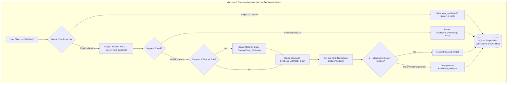

# Architectural Audit Report: `docs/designs/jintru_claim_verification.md`

**Auditor:** Skeptical Architect (Zoom Out Goldfish)  
**Standard Applied:** [Zoom Out Standard](file:///home/omprakash/.gemini/config/plugins/egm/resources/document_standards/zoom-out-standard.md)  
**Target Document:** [`docs/designs/jintru_claim_verification.md`](file:///home/omprakash/Documents/jintru/docs/designs/jintru_claim_verification.md) (770 lines)  
**Reference Docs:** [`docs/designs/concepts_brief.md`](file:///home/omprakash/Documents/jintru/docs/designs/concepts_brief.md), [`docs/specification.md`](file:///home/omprakash/Documents/jintru/docs/specification.md)  
**Mode:** REVIEW (Stage 5 — Initial Zoom Out Protocol Audit)  
**Review Verdict:** 🟢 **PASS (0 Blockers, 0 Majors, 3 Nits)**

---

### Executive Summary

A comprehensive 30,000-foot architectural review was conducted on the revised master design document `docs/designs/jintru_claim_verification.md` against the [Zoom Out Standard](file:///home/omprakash/.gemini/config/plugins/egm/resources/document_standards/zoom-out-standard.md) and the project constraints established in `docs/designs/concepts_brief.md` and `docs/specification.md`.

The revised architecture represents an exemplary model of high-altitude simplicity, root-cause problem focus, and strict YAGNI adherence. All previous critical architectural flaws—specifically the unviable serialization of two remote LLM round-trips inside an 8.0s synchronous SLA, the combinatorial complexity of compound claim decomposition, the fragile userland socket-level SSRF transport, and the over-normalized 4-table relational database—have been decisively eliminated.

The architecture strictly adheres to the converged Milestone 1 vertical slice:
1. **Single Factual Claim Input:** Bound strictly to $\le 500$ characters; proposition carving is cleanly deferred to Phase 2 (NG-1).
2. **Sequential Two-Stage Retrieval:** At most 1 query in Stage 1 and at most 1 targeted counter-query in Stage 2 (triggered only when evidence is disputed and remaining time is $\ge 3.5\text{s}$), naturally protecting provider rate limits without token-bucket bloat.
3. **Single Structured Synthesis LLM Round-Trip:** Gate A deterministic screening short-circuits subjective claims, future predictions, and empty searches with 0 LLM calls; when usable evidence exists, a single structured LLM call synthesizes the verdict with an enforced $\ge 1.5\text{s}$ execution window.
4. **Snippet-First Network Boundary:** Ingestion is restricted to search provider snippets and LLM context summaries, eliminating raw web page scraping and architectural SSRF vectors entirely.
5. **Flat SQLite Persistence:** A single `verifications` table with structured JSON columns running in WAL mode with a 5,000ms busy timeout and backoff retries provides bulletproof local persistence without ORM/migration overhead.
6. **Robust Implementation Phasing:** An 8-phase zero-decision build sequence replaces the previous flat file inventory, complete with concrete Pydantic schemas, database wrapper code, and testable exit checks.

With **0 Blockers** and **0 Majors**, the document earns an unequivocal **PASS** verdict.

---

### Master Review Checklist (Zoom Out Standard)

| Criterion | Evaluation Lens | Status | Architectural Assessment |
| :--- | :--- | :---: | :--- |
| **0. Context Sufficiency** | Problem definition & motivation | ✅ PASS | Clearly articulates the 5 systemic failure modes in RAG/automated verification and defines the core mission. |
| **1. Root Problem Focus** | Core mission alignment | ✅ PASS | Directly addresses confirmation bias, syndicated consensus, and hallucinated plausibility through dialectical retrieval and two-domain corroboration. |
| **2. Simplicity & YAGNI** | Code minimization & scope control | ✅ PASS | Pruned speculative PDF exports, client settings API, and MinHash algorithms; strictly scopes Milestone 1 to single claims. |
| **3. Latency & Budget Viability** | Synchronous 8.0s SLA compliance | ✅ PASS | Reconciles stage budgets (0.2s + 2.5s + 2.0s + 3.0s + 0.3s = 8.0s) and consolidates model inference into a single call. |
| **4. Architectural Fit & Boundaries**| Abstraction & component layering | ✅ PASS | Clean separation: API gateway $\rightarrow$ pipeline orchestrator $\rightarrow$ provider adapters $\rightarrow$ SQLite repository. |
| **5. Leverage Existing** | Standard platform conventions | ✅ PASS | Replaces custom socket proxies with standard search snippets; replaces Alembic/SQLAlchemy with native `aiosqlite`. |
| **6. Zero-Decision Plan** | Implementation readiness | ✅ PASS | 8 sequential, testable build phases with explicit schemas, concrete database methods, and quantitative CI thresholds. |

---

### Detailed Findings

#### 🔴 Blocker Findings (0)
*None. All previous blocker findings (B-01 through B-07) have been fully resolved.*

#### 🟡 Major Findings (0)
*None. All previous major findings (M-01 through M-011) have been fully resolved.*

#### 🟢 Nit Findings (3)

##### Finding 1: Dependency Tag for Tailwind CSS v4 in Frontend Package
* **Severity:** 🟢 **Nit**
* **Affected Scope:** Section Detailed Implementation Plan, Phase 6 (lines 694, 697).
* **Simplicity Rationale:**
  In `frontend/package.json`, `@tailwindcss/vite` and `tailwindcss` are pinned to `^4.0.0-beta.4`. Tailwind CSS v4 is generally available in stable release (`^4.0.0`). While functional, using a pre-release beta tag introduces unnecessary version churn during build setup.
* **Suggested Simplification:**
  Update to stable `"tailwindcss": "^4.0.0"` and `"@tailwindcss/vite": "^4.0.0"`.

##### Finding 2: Unused `status` Column in SQLite Flat Schema
* **Severity:** 🟢 **Nit**
* **Affected Scope:** Section 7 (lines 281, 534, 557).
* **Simplicity Rationale:**
  The `verifications` table schema defines a `status TEXT NOT NULL` column, which `save_verification()` hardcodes to `"completed"`. However, `VerificationResponse` and `VerificationListItem` schemas omit this field since all persisted records in Milestone 1 are completed verifications. Maintaining a static column that is never queried or surfaced in API schemas is redundant.
* **Suggested Simplification:**
  Either remove the `status` column from `CREATE TABLE verifications` to keep the table strictly aligned with `VerificationResponse`, or add `status: str = "completed"` to `VerificationListItem` if reserved for future asynchronous job state tracking.

##### Finding 3: Synchronous Directory Creation in Database Constructor
* **Severity:** 🟢 **Nit**
* **Affected Scope:** Section Detailed Implementation Plan, Phase 2 (`Database.__init__`, line 523).
* **Simplicity Rationale:**
  `Database.__init__()` executes `Path(self.db_path).parent.mkdir(parents=True, exist_ok=True)`. While completely benign during application bootstrapping, performing synchronous filesystem operations inside an asynchronous service constructor can be deferred to `async def init_db()`.
* **Suggested Simplification:**
  Move the directory creation call inside `init_db()` alongside SQLite file creation and pragma execution.

---

### Architectural Verification Summary

### Conclusion & Stage 5 Sign-Off

`docs/designs/jintru_claim_verification.md` is architecturally robust, pragmatically scoped, and completely aligned with the **Zoom Out Standard**. The system avoids premature optimizations, adheres strictly to the single-claim vertical slice, respects the 8.0-second SLA, and provides a clear, phased blueprint for implementation.

**Final Verdict:** 🟢 **PASS** — Approved to proceed to downstream comprehension and implementation readiness phases.
